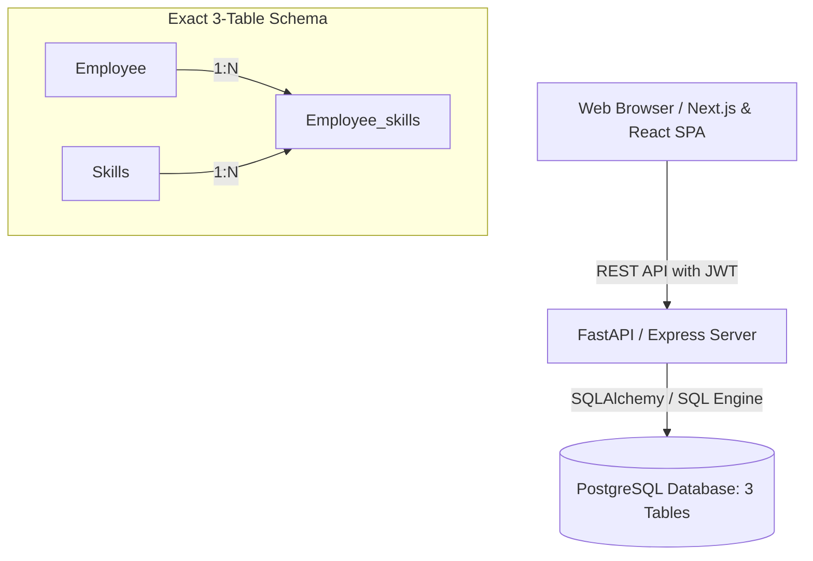

# Evonence Employee Skill Matrix

An internal enterprise web application engineered for **Evonence** to maintain organization-wide skill hierarchies, enable engineers to submit competency self-ratings (1–5) with justifications, empower engineering managers to review, adjust, and approve ratings, and provide a visual **Employee × Skill Matrix** for project and task allocation.

---

## 1. Architecture & Tech Stack



### Technology Stack

* **Frontend:** React 19, TypeScript, Tailwind CSS, Lucide Icons, Motion, Vite.
* **Backend:** Python 3.12+ FastAPI, Pydantic v2, SQLAlchemy 2, Alembic, Passlib/Bcrypt, JWT (HS256).
  *(The Express server serves the frontend and proxies `/api` requests to FastAPI; application data is stored in PostgreSQL.)*
* **Database:** PostgreSQL 16 (strict 3-table relational schema).
* **Containerization:** Docker & Docker Compose (`db`, `backend`, `frontend`).
* **Automated Testing:** Pytest, FastAPI TestClient, Playwright End-to-End.

---

## 2. Authoritative Database Schema (Exact 3 Tables)

Per the strict architectural constraints, the system operates with **exactly three database tables**:

### TABLE 1: `Employee`
| Column | Type | Description |
|---|---|---|
| `emp_id` | SERIAL PRIMARY KEY | Unique employee record identifier |
| `fName` | VARCHAR(100) NOT NULL | First name |
| `lName` | VARCHAR(100) NOT NULL | Last name |
| `Login_userid` | VARCHAR(100) UNIQUE NOT NULL | Unique login handle |
| `Login_password` | VARCHAR(255) NOT NULL | Secure salted Bcrypt password hash (never plaintext) |
| `is_active` | BOOLEAN NOT NULL DEFAULT true | Account status flag |
| `created_on` | TIMESTAMP NOT NULL | Account creation timestamp |
| `updated_on` | TIMESTAMP NOT NULL | Last update timestamp |
| `last_logged_in` | TIMESTAMP NULL | Last authentication timestamp |
| `roles` | VARCHAR(50) NOT NULL | `SUPER_ADMIN`, `MANAGER`, or `EMPLOYEE` |
| `profile_picture` | TEXT NULL | Validated PNG/JPEG/WebP image data stored on the employee record (max 2 MB) |

### TABLE 2: `Skills`
| Column | Type | Description |
|---|---|---|
| `skill_id` | SERIAL PRIMARY KEY | Primary key |
| `skill_type` | VARCHAR(100) NOT NULL | `Hard skills` or `Soft skills` |
| `category_name` | VARCHAR(100) NOT NULL | Category grouping (e.g. `Cloud & Infrastructure`) |
| `category_id` | INTEGER NOT NULL | Numerical category identifier (e.g. `103`) |
| `skillname` | VARCHAR(150) NOT NULL | Competency name (e.g. `Google Cloud Platform`) |
| `skill_description` | TEXT NOT NULL | Human-readable skill description |

The centralized skill catalog is loaded from `backend/data/centralized_skills.json` by the local database seeder. It contains 299 unique skills from the supplied workbook; the repeated `Zero Trust Architecture` row is represented once using its first workbook entry. Seeding updates matching skills in place, preserves their IDs and employee ratings, and leaves existing skills not present in the workbook intact.

### TABLE 3: `Employee_skills`
| Column | Type | Description |
|---|---|---|
| `unique_id` | SERIAL PRIMARY KEY | Primary key |
| `skill_id` | INTEGER NOT NULL | FK → `Skills.skill_id` (ON DELETE CASCADE) |
| `emp_id` | INTEGER NOT NULL | FK → `Employee.emp_id` (ON DELETE CASCADE) |
| `self_rating` | NUMERIC(2,1) NOT NULL | CHECK (`self_rating >= 0.5 AND self_rating <= 5`) |
| `comments` | TEXT NULL | Experience justification and review audit trail |
| `is_active` | BOOLEAN NOT NULL DEFAULT true | Record status (set to `false` if rejected) |
| `add_update_timestamp` | TIMESTAMP NOT NULL | Timestamp of addition or modification |

---

## 3. Role-Based Access Control (RBAC)

The application enforces 3 distinct roles:

1. **SUPER_ADMIN:**
   - Full authority over employee accounts (create, edit, reset passwords, deactivate, delete).
   - Full authority over skills taxonomy (add, edit, categorize, delete).
   - View organizational skill matrix and override reviews.
   - Access to database seed reset tooling.
2. **MANAGER:**
   - View team directories and engineering competency profiles.
   - Access the **Skill Review & Approvals** hub to approve, adjust ratings, or reject ratings.
   - Utilize the **Employee Skill Matrix** and **Resource Allocation Helper** to identify skill gaps and assign qualified engineers to client projects.
3. **EMPLOYEE:**
   - Maintain profile details (name, password).
   - Browse the organizational skill hierarchy (`skill_type` → `category_name` → `skillname`).
   - Submit and update 1–5 self-ratings with experience justification comments at any time.
   - View their personalized dashboard and competency matrix.

---

## 4. Development Login Credentials

The database is pre-seeded with sample credentials:

| Role | Username | Password | Full Name | Notes |
|---|---|---|---|---|
| **Super Admin** | `admin` | `Admin@123` | Evonence Admin | Full system administration |
| **Super Admin** | `superadmin@evonence.com` | Existing password (unchanged) | Tanaya Korhalkar | Full system administration |
| **Manager** | `manager` | `Manager@123` | Sarah Connor | Team reviews & project allocation |
| **Employee** | `tanaya.korhalkar@evonence.com` | Existing password (unchanged) | Tanaya Korhalkar | Senior Python & Cloud Engineer |
| **Employee** | `ayush.joshi@evonence.com` | Existing password (unchanged) | Ayush Joshi | Lead TypeScript & React Architect |
| **Employee** | `siddhesh.bhor@evonence.com` | Existing password (unchanged) | Siddhesh Bhor | GCP DevOps & Kubernetes Specialist |
| **Employee** | `vivek.dabhade@evonence.com` | Existing password (unchanged) | Vivek Dabhade | PostgreSQL & Data Lead |

---

## 5. Docker Setup (Recommended)

Start the entire application (Frontend, Backend, and PostgreSQL) with a single command:

```bash
docker compose up --build
```

### Service Endpoints:
* **Frontend Web App:** `http://localhost:3000`
* **FastAPI REST API Docs:** `http://localhost:8000/docs`
* **PostgreSQL:** `localhost:5432` (`employeeskilllmatrix` database)

To stop services:
```bash
docker compose down -v
```

---

## 6. Local Setup Without Docker

### Prerequisites
* Node.js 20+ & npm
* Python 3.12+ (for FastAPI backend)
* PostgreSQL 16 (or SQLite for automated testing)

### Step 1: Running the Application Dev Server (Vite + Node Full-Stack)
```bash
# Install dependencies
npm install

# Start development server on port 3000
npm run dev
```

### Step 2: Run the Python FastAPI Backend
Configure the connection to your local PostgreSQL instance in PowerShell (replace the username and password with your local PostgreSQL credentials):
```powershell
$env:POSTGRES_SERVER = "localhost"
$env:POSTGRES_PORT = "5432"
$env:POSTGRES_USER = "postgres"
$env:POSTGRES_PASSWORD = "<your-local-postgres-password>"
$env:POSTGRES_DB = "employeeskilllmatrix"
```

Create the database once if it does not already exist:
```powershell
createdb -h $env:POSTGRES_SERVER -p $env:POSTGRES_PORT -U $env:POSTGRES_USER $env:POSTGRES_DB
```

If you have set `DATABASE_URL`, ensure it points to `employeeskilllmatrix`; it takes precedence over the individual `POSTGRES_*` settings.

```powershell
Set-Location backend
python -m venv .venv
.\.venv\Scripts\Activate.ps1
python -m pip install -r requirements.txt

# Run Alembic migrations
alembic upgrade head

# Seed database
python -m app.database.seed

# Start FastAPI server on port 8000
python -m uvicorn app.main:app --host 0.0.0.0 --port 8000 --reload
```

On Windows, `backend\connect-local.ps1` prompts for the local `postgres` password without echoing it, creates `employeeskilllmatrix` if needed, runs migrations and seeding, then starts the API. The web app proxies its `/api` requests to this backend, so both services must be running:
```powershell
cd backend
py -3.12 -m venv .venv
.\.venv\Scripts\python.exe -m pip install -r requirements.txt
.\connect-local.ps1
```

---

## 7. Automated Testing

### Backend Unit & Integration Tests (Pytest)
```bash
cd backend
pytest -v
```
Tests verify:
* Successful & failed logins (password hash check).
* JWT token authentication middleware.
* RBAC permission enforcement on protected routes.
* Rating constraint validation (checks 1–5 bounds).
* CRUD operations across Employee, Skills, and Employee_skills.
* Manager review approval/rejection lifecycle.

### End-to-End Tests (Playwright)
```bash
npx playwright test
```
Validates the complete workflow:
`Login → Dashboard → Browse Skills → Submit Rating (1-5) → Save → Manager Login → Review Rating → Approve → Check Skill Matrix`.

---

## 8. REST API Reference

### Authentication
* `POST /api/auth/login` — Authenticate `Login_userid` + `password`, return JWT & user object.
* `POST /api/auth/register` — Public employee registration; the email is saved as `Login_userid`, and the password is stored as a secure hash in `Employee`.
* `GET  /api/auth/me` — Return currently authenticated user from Bearer token.
* `POST /api/auth/logout` — Invalidate user session.

### Employees
* `GET    /api/employees` — List employees (supports search, role, and active status filters).
* `GET    /api/employees/{emp_id}` — Get employee by ID.
* `POST   /api/employees` — Create employee (*Super Admin*).
* `PUT    /api/employees/{emp_id}` — Update employee details/password.
* `DELETE /api/employees/{emp_id}` — Delete employee (*Super Admin*).

### Skills
* `GET    /api/skills` — List all skills (supports `search`, `skill_type`, `category_name`).
* `GET    /api/skills/{skill_id}` — Get single skill.
* `POST   /api/skills` — Create skill (*Super Admin*).
* `PUT    /api/skills/{skill_id}` — Update skill (*Super Admin*).
* `DELETE /api/skills/{skill_id}` — Delete skill (*Super Admin*).

### Employee Skills
* `GET    /api/employee-skills` — List ratings (filterable by `emp_id`, `skill_id`, `is_active`).
* `GET    /api/employee-skills/{unique_id}` — Get single rating record.
* `POST   /api/employee-skills` — Create or update self-rating (1–5) and comments.
* `PUT    /api/employee-skills/{unique_id}` — Edit self-rating.
* `POST   /api/employee-skills/{unique_id}/review` — Manager review: `APPROVE`, `EDIT`, or `REJECT`.
* `POST /api/employee-skills/{emp_id}/review-batch` — Manager approves or rejects all currently pending submissions for one employee; already reviewed skills are left unchanged.
* `DELETE /api/employee-skills/{unique_id}` — Delete rating record (*Super Admin*).

### Analytics & System
* `GET  /api/stats/dashboard` — Aggregated metrics, competency distributions, skill gaps & strengths.
* `POST /api/system/reset-seed` — Reset database to baseline sample seed data.

---

## 9. Known Limitations & Schema Design Analysis

Per the instruction to strictly use **exactly 3 tables** (`Employee`, `Skills`, `Employee_skills`) and not silently add tables or columns:

1. **Manager-to-Employee Mapping Limitation:**
   - *Constraint:* The `Employee` table does not contain a `manager_id` column, nor is there a department/team mapping table.
   - *Implemented Behavior:* Managers have organizational visibility across all active engineers for skill review and allocation. In a future unconstrained schema, adding `manager_id INTEGER REFERENCES Employee(emp_id)` or a `Department_teams` table would allow team-scoped manager filtering.
2. **Approval State Persistence:**
   - *Constraint:* The `Employee_skills` table does not have `approval_status`, `reviewed_by`, or `reviewed_at` columns.
   - *Implemented Behavior:*
     - When approved: The manager's approval annotation is prepended to `comments` (e.g. `[Approved by Sarah Connor on 2026-10-05 09:30]`), `add_update_timestamp` is updated, and `is_active` remains `true`.
     - When adjusted: The rating is updated to the reviewed score and recorded in `comments`.
     - When rejected: `is_active` is set to `false`, effectively removing the rating from the active Matrix while preserving the record.
     - *Recommended Future Schema:* Add `approval_status VARCHAR(20) DEFAULT 'PENDING'`, `manager_rating SMALLINT`, `reviewed_by INTEGER REFERENCES Employee(emp_id)`, and `reviewed_at TIMESTAMP`.
